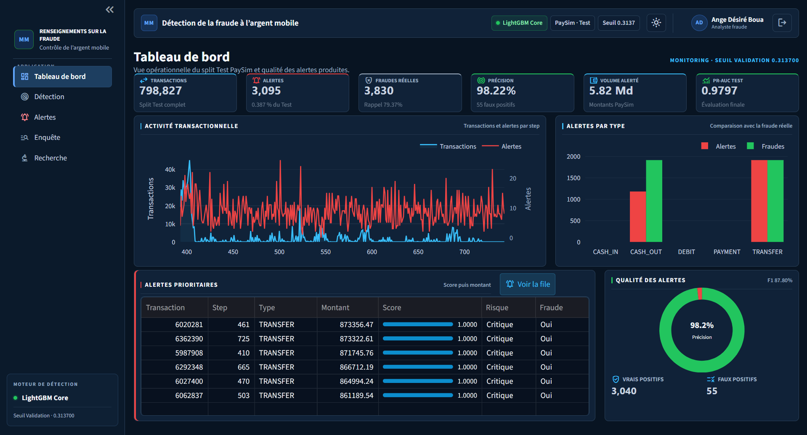
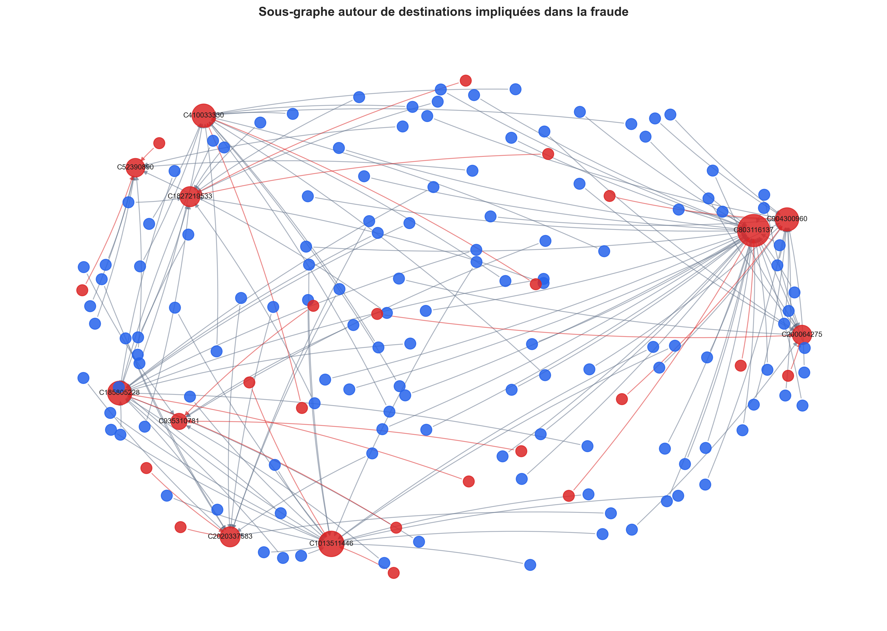
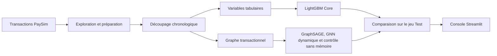
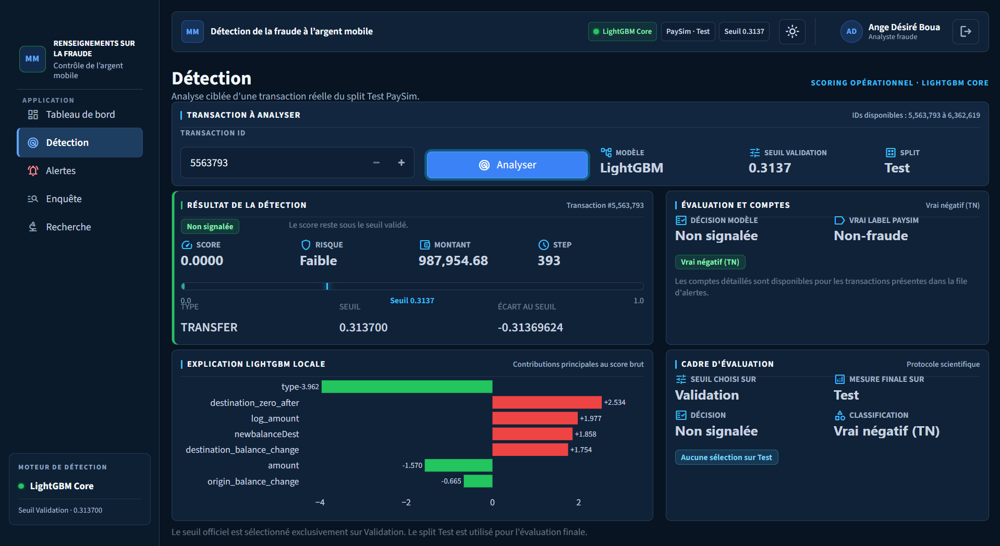
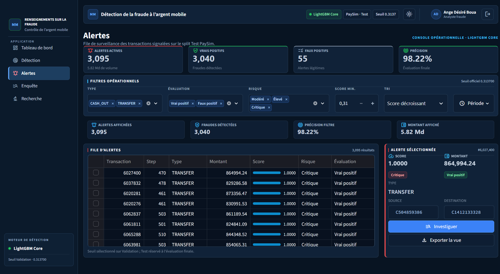
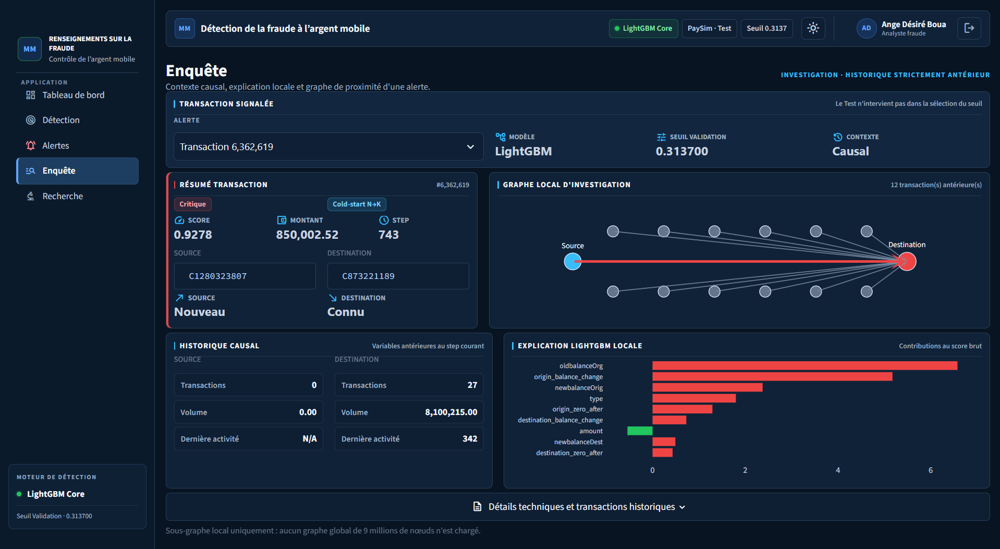
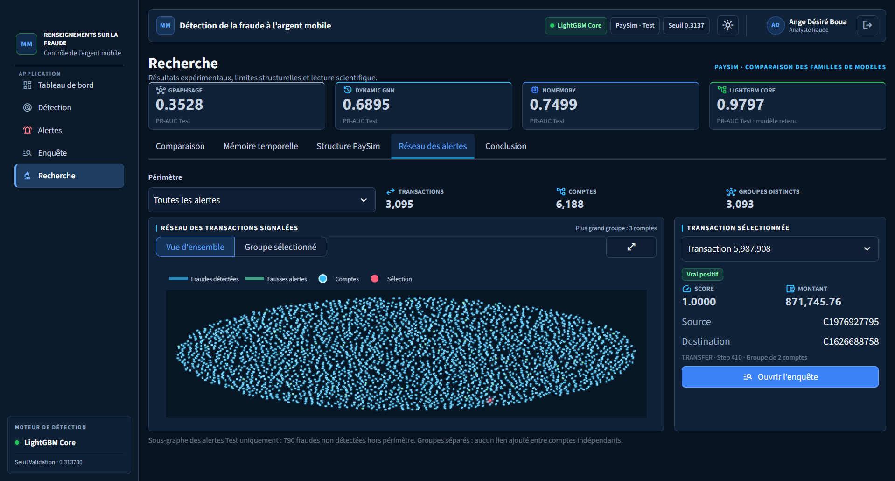
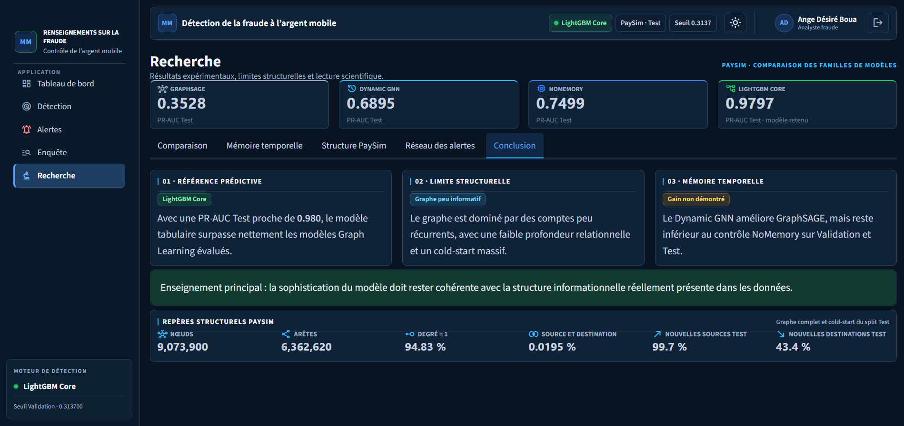

# Détection de fraude Mobile Money par apprentissage sur graphes dynamiques

**Projet de fin d’études · Master 2 Big Data et Intelligence Artificielle**

Une étude comparative de la fraude transactionnelle sur **PaySim**, de l’analyse exploratoire à une console d’investigation Streamlit. Le projet mesure l’apport du graphe et de la mémoire temporelle face à une référence tabulaire LightGBM.

[Contexte](#contexte-et-objectif) · [Pipeline](#pipeline-expérimental) · [Résultats](#résultats) · [Application](#application-streamlit) · [Installation](#installation-locale)

## Aperçu du projet

| 6 362 620 | 0,129 % | 0,9797 |
| :---: | :---: | :---: |
| Transactions simulées | Fraudes dans PaySim | PR-AUC de LightGBM Core sur Test |



*Le tableau de bord présente l’activité transactionnelle et les alertes produites par LightGBM Core sur le jeu Test PaySim.*

[Voir les autres écrans de la console](#captures-de-lapplication)

## Contexte et objectif

Les opérations Mobile Money produisent des flux volumineux dans lesquels les fraudes sont rares. Pour orienter une investigation, un analyste doit pouvoir prioriser les transactions signalées et comprendre les facteurs qui influencent leur score.

> Représenter les transactions sous forme de graphe et mémoriser les interactions passées améliore-t-il la détection par rapport à un modèle tabulaire ?

Le projet teste cette question en comparant **LightGBM Core**, **GraphSAGE**, un **GNN dynamique** et un **contrôle neuronal sans mémoire**, puis présente les résultats dans un démonstrateur interactif.

## Données

| Élément | Description |
| --- | --- |
| Source | [PaySim](https://www.kaggle.com/datasets/ealaxi/paysim1), jeu de données synthétique de transactions Mobile Money |
| Unité d’analyse | Une transaction entre un compte source et un compte destinataire |
| Variables | Type d’opération, montant, soldes, identifiants de comptes et pas horaire |
| Cible | `isFraud`, avec 8 213 transactions frauduleuses |
| Graphe | 9 073 900 comptes et 6 362 620 transactions représentées par des liens orientés |

Les statistiques descriptives sont disponibles dans le [rapport de compréhension des données](reports/data_understanding/data_understanding_summary.json).

<details>
<summary>Sous-graphe de l’analyse exploratoire</summary>



*Les nœuds représentent des comptes simulés et les liens représentent des transactions.*

</details>

## Pipeline expérimental



| Étape | Travail réalisé | Notebook |
| --- | --- | --- |
| Explorer | Vérifier la qualité des données, mesurer le déséquilibre et étudier les profils de fraude | [Compréhension](notebooks/01_data_understanding2.ipynb) · [EDA](notebooks/02_EDA.ipynb) |
| Préparer | Construire des variables transactionnelles et des historiques de comptes | [Feature engineering](notebooks/03_feature_engineering.ipynb) |
| Construire le graphe | Transformer les comptes en nœuds et les transactions en liens orientés | [Construction du graphe](notebooks/05_graph_construction.ipynb) |
| Comparer | Entraîner les modèles tabulaires et les modèles de graphe, puis tester l’apport de la mémoire | [LightGBM](notebooks/04_machine_learning_baseline.ipynb) · [GraphSAGE](notebooks/06_gnn_baseline.ipynb) · [GNN dynamique](notebooks/07_dynamic_gnn.ipynb) |
| Synthétiser | Comparer les résultats et préparer les fichiers consommés par l’application | [Synthèse](notebooks/08_synthese_scientifique.ipynb) · [Audit applicatif](notebooks/09_application_audit.ipynb) |

**Protocole temporel.** Entraînement sur les pas **1 à 334**, validation sur **335 à 392**, test sur **393 à 743**. Pour prédire les transactions d’un pas donné, le contexte du graphe se limite aux pas antérieurs. La validation sert à choisir les modèles et leurs seuils. Le jeu Test sert à l’évaluation finale.

## Résultats

La **PR-AUC** est la métrique principale, car elle résume le compromis précision-rappel sur la classe fraude, très minoritaire. Les autres métriques sont calculées aux seuils fixés sur la validation.

| Modèle | PR-AUC validation | PR-AUC test | Précision test | Rappel test | F1 test |
| --- | ---: | ---: | ---: | ---: | ---: |
| GraphSAGE | 0,2401 | 0,3528 | 92,79 % | 16,48 % | 0,2798 |
| GNN dynamique | 0,5474 | 0,6895 | 94,54 % | 43,42 % | 0,5951 |
| Contrôle sans mémoire | 0,6066 | 0,7499 | 93,73 % | 50,39 % | 0,6555 |
| **LightGBM Core** | **0,9297** | **0,9797** | **98,22 %** | **79,37 %** | **0,8780** |

Le GNN dynamique améliore GraphSAGE de **0,3367** point de PR-AUC sur Test. Le contrôle sans mémoire dépasse le GNN dynamique. Sur PaySim et dans ce protocole, LightGBM Core arrive en tête de cette comparaison et alimente le démonstrateur.

Au seuil de **0,3137**, LightGBM Core signale **3 095 alertes** sur **798 827 transactions Test**. Parmi elles, **3 040** correspondent à des fraudes et **55** sont des fausses alertes. **790** fraudes restent non détectées.

Sources des résultats : [synthèse scientifique](notebooks/08_synthese_scientifique.ipynb) · [résultats tabulaires](results/final_test_results.csv) · [protocole de sélection](results/final_protocol.csv).

## Application Streamlit

La console permet d’explorer les prédictions du jeu Test et d’expliquer les scores de LightGBM Core à partir des contributions des variables.

| Page | Usage |
| --- | --- |
| **Tableau de bord** | Vue d’ensemble des volumes, des alertes et des indicateurs de performance |
| **Détection** | Recherche d’une transaction par identifiant, consultation du score et de son explication |
| **Alertes** | Filtrage, consultation des transactions signalées et export CSV |
| **Enquête** | Historique des comptes concernés, graphe local et facteurs qui influencent le score |
| **Recherche** | Comparaison des modèles, structure de PaySim et exploration du réseau des alertes |

[Code de l’application](app/) · [Audit applicatif](notebooks/09_application_audit.ipynb)

### Captures de l’application

<details>
<summary><strong>Détection</strong></summary>



*Analyse d’une transaction du jeu Test et explication de son score LightGBM.*

</details>

<details>
<summary><strong>Alertes</strong></summary>



*Tri et filtrage des alertes avant l’ouverture d’une enquête.*

</details>

<details>
<summary><strong>Enquête</strong></summary>



*Examen du contexte d’une alerte à partir des transactions antérieures.*

</details>

<details>
<summary><strong>Recherche — réseau des alertes et conclusion</strong></summary>

**Réseau des alertes**



**Conclusion scientifique**



</details>

## Installation locale

1. Cloner le dépôt et créer un environnement Python 3.13.

   ```bash
   git clone https://github.com/angedesire-boua/MobileMoney-Fraud-GNN.git
   cd MobileMoney-Fraud-GNN
   python -m venv .venv
   ```

2. Activer l’environnement. Sous Windows PowerShell, utiliser `.\.venv\Scripts\Activate.ps1`. Sous macOS ou Linux, utiliser `source .venv/bin/activate`.

   ```bash
   python -m pip install -r requirements.txt
   ```

3. Télécharger [PaySim](https://www.kaggle.com/datasets/ealaxi/paysim1) et placer le CSV dans `data/raw/paysim.csv`. Pour régénérer les fichiers nécessaires au démonstrateur, exécuter les notebooks de `01` à `09` dans l’ordre, en ajustant les chemins locaux au besoin. Les notebooks utilisent aussi Jupyter, Matplotlib, Seaborn, scikit-learn, psutil, SHAP, PyTorch et PyTorch Geometric.

4. Copier [`.streamlit/secrets.example.toml`](.streamlit/secrets.example.toml) vers `.streamlit/secrets.toml`. Renseigner un identifiant et l’empreinte SHA-256 du mot de passe de démonstration.

5. Depuis la racine du projet, lancer la console.

   ```bash
   python -m streamlit run app/app.py
   ```

Le CSV PaySim se télécharge séparément. Les notebooks génèrent les données préparées, les modèles entraînés et les fichiers utilisés par la console. Les figures et les tableaux du dépôt permettent de consulter les résultats dès le clonage.

## Technologies et structure du dépôt

| Domaine | Outils |
| --- | --- |
| Analyse et préparation | Python, Pandas, NumPy, PyArrow |
| Modélisation | LightGBM, scikit-learn, PyTorch, PyTorch Geometric |
| Graphes et visualisation | NetworkX, Matplotlib, Seaborn, Plotly |
| Interface | Streamlit |

```text
MobileMoney-Fraud-GNN/
├── app/                 Console Streamlit et fonctions d’investigation
├── docs/screenshots/    Captures de l’application
├── notebooks/           Analyses, entraînements et audit
├── reports/             Figures et tableaux d’analyse
├── results/             Métriques et paramètres de sélection
├── tests/               Tests du réseau des alertes
├── .streamlit/          Configuration et exemple de secrets locaux
└── requirements.txt     Dépendances de l’application
```

Tests du réseau d’alertes : `python -m unittest discover -s tests`.

## Périmètre et limites

Les résultats portent sur des **transactions simulées**. La fragmentation du graphe et la fréquence des nouveaux comptes limitent les historiques exploitables. Une validation sur des données d’opérateur et avec des variables disponibles au moment du scoring serait nécessaire pour évaluer un usage opérationnel.

**Auteur** · [Zoumandrey Ange Désiré Boua](https://github.com/angedesire-boua)
